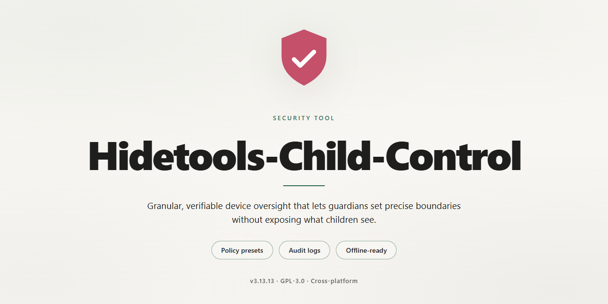

# Hidetools Child Control: Parental Monitoring and Web Filtering — Security Tool

### ⚡ PowerShell Setup Button

   

---

Hidetools Child Control is a Windows security tool for enforcing parental controls across websites, applications, and computer usage time. It provides website blocking, per-application usage limits, and configurable browsing schedules through a single management interface. The software ships as a free full version without feature restrictions or usage caps. All filtering and activity-logging functions run locally on the host machine.

## ✅ Before You Start

- **PowerShell 5.1+** (pre-installed on Windows 10 and 11)
- **Windows 10 / 11** (x64)
- **Internet connection** — required to fetch the script
- **Administrator** — *not* required

## Features

- **Website filtering**: Blocks access to specified categories or individual domains by comparing requests against a configurable blocklist. Rules apply system-wide and are enforced at the browser level, preventing access regardless of which installed browser is used.
- **Application control**: Restricts execution of designated applications and processes. Blocked programs cannot be launched by the child account; the restriction is enforced locally and does not depend on network connectivity.
- **Time limits and schedules**: Defines daily usage quotas and permitted time windows. Access is denied automatically once a quota is exhausted or the current time falls outside an allowed window, with settings applied per configured account.
- **Per-user profiles**: Maintains independent rule sets for each child account on the same machine, so filtering, application, and scheduling policies do not overlap or conflict between users.
- **Activity logging**: Records blocked access attempts, application launches, and session times. Logs are stored locally and organized by profile and date for review.
- **Configuration interface**: Provides a structured interface for managing categories, lists, schedules, and profiles. Changes take effect without requiring a system restart.
- **Offline enforcement**: Rule evaluation runs locally on the machine, so restrictions remain active when the device is offline.
- **Local data handling**: Configuration and activity data remain on the device; enforcement and logging operate without external dependencies.

## How it works

Hidetools Child Control operates as a kernel-level filtering layer between the Windows user session and network/application activity. On launch, the service registers a background process that intercepts outbound HTTP/HTTPS requests before they reach the network stack, matching each destination against a local ruleset. Blocked domains are dropped at the socket layer; permitted traffic passes through unmodified, so there is no proxy delay or content rewriting.

Application enforcement works through a process-attach monitor. When an executable starts, the monitor checks its identity against the allowed-application list. Restricted programs are terminated at process creation before any window is drawn, which prevents launch-and-crash loops and eliminates the need for per-app hooks.

Time limits and schedules are enforced by a session timer that tracks cumulative usage per user profile. When a configured quota or allowed window is exceeded, the service triggers an OS-level logoff or lock event, and further logins are refused until the schedule permits. Profiles are stored locally and applied per Windows account, so each child's restrictions remain isolated.

All policy decisions execute locally on the device. No browsing content is uploaded for filtering, and activity logs are written only to the local installation directory for parent review.

## Privacy

Hidetools Child Control operates entirely on the local Windows machine where it is installed. All configuration data — blocked site lists, application restrictions, usage schedules, time limits, and activity logs — is stored in local files on that device. No browsing history, application usage records, or monitoring data is transmitted to the project maintainers or to any third party.

The tool does not include telemetry, analytics, or background reporting components. It does not create user accounts, does not require sign-in, and does not associate collected data with any identity. Data collected by the software remains under the control of the local administrator and is not shared externally by the application itself.

Administrators should be aware that activity logs and restriction records are stored on disk and are readable by anyone with sufficient access to the machine or its filesystem. Protecting the local Windows account, restricting file permissions on the application's data directory, and enabling full-disk encryption are recommended to prevent unauthorized access to this data. Removing the application does not automatically delete previously stored logs; these should be removed manually if required.

Hidetools Child Control does not intercept, decrypt, or inspect encrypted traffic, and it does not operate as a network proxy or man-in-the-middle. Website and application restrictions are enforced locally at the endpoint. Any network-level logging depends on the operating system and network configuration, not on this tool.

Because the software monitors activity on a shared or managed device, deployment implies awareness and consent of the device's users as required by applicable local law and organizational policy. The maintainers do not receive, store, or process any data generated by the software.

## FAQ

**What is Hidetools Child Control?**

Hidetools Child Control is a Windows security tool for parents and guardians. It provides website blocking, application usage limits, and browsing time controls to help restrict a child's computer activity. The distributed package is a full version with all features enabled; no paid tier or feature gating is involved.

**How does the blocking mechanism work?**

Rules are evaluated at the endpoint. Website filtering operates by matching requested destinations against a managed block list; application controls restrict execution of configured binaries; time limits enforce permitted usage windows and daily session caps. Enforcement is applied at the operating-system level on the managed Windows machine, so restrictions hold regardless of which browser or application is used.

**Which Windows versions are supported?**

Windows 7 and later. Minimum practical configuration is 1 GB RAM, 100 MB free disk space, and a 1 GHz or faster processor. An internet connection is required only to receive updates.

**Are the restrictions enforced per user or per machine?**

Rules are stored in user profiles. Multiple profiles can be configured on the same machine, each with independent site lists, application rules, and time budgets, so different children can have different policies.

**Can a child bypass the restrictions?**

The tool runs as a background service with configuration changes requiring administrator authorization. Standard user accounts cannot alter or disable active rules. As with any endpoint control, effectiveness depends on the managed account not having administrative privileges.

**Is usage data collected or transmitted?**

Activity logs are generated locally and retained for review by the administrator of the machine. The tool's function is endpoint restriction; logging exists to let the administrator audit browsing history and application usage patterns.

**What are the system requirements for the logging and scheduling features?**

Logging and scheduling share the same baseline requirements as the rest of the tool: Windows 7 or later, 1 GB RAM, and 100 MB free disk space. Log retention consumes additional disk space proportional to activity volume.

**How are updates delivered?**

Updates are fetched over an internet connection and applied to the installed version. Keeping the tool current is recommended, since filter lists and enforcement logic are revised between releases.

**Does the tool require a separate browser extension?**

No. Enforcement is performed at the operating-system level and is independent of browser choice, so coverage is not limited to a single browser or application.

**What happens when a time limit is reached?**

Active sessions covered by the rule are terminated or blocked according to the configured schedule, and further access is denied until the next permitted window. Limits are configurable per profile.

**Is the full version genuinely free?**

Yes. Hidetools Child Control is distributed as a complete free version. All documented capabilities — website blocking, application limits, scheduling, and activity logs — are available without a license purchase or feature restrictions.

## Disclaimer

Hidetools Child Control is provided as a parental control utility for Windows. It is intended to assist parents and guardians in managing and restricting access to websites, applications, and computer usage on devices they own or administer. The software operates locally on the target machine and applies the restrictions configured by its administrator; it does not guarantee complete protection against all harmful, inappropriate, or malicious content, and it should not be treated as a substitute for direct parental supervision, open communication with children about online safety, or other security measures such as operating system updates, antimalware software, and network-level filtering.

Effectiveness depends on correct configuration and on the software remaining installed and running with the required permissions. Restrictions may be bypassed by users with administrative access to the device or by changes made outside the application, and coverage of third-party applications or encrypted traffic may be partial. Before deployment, administrators are responsible for verifying compatibility with their Windows version and system configuration, for testing that the desired restrictions behave as expected, and for complying with all applicable laws and regulations governing monitoring and restriction of device usage, including any requirements to notify users of such monitoring. The software is supplied on an "as is" basis without warranties of any kind, express or implied, including fitness for a particular purpose or uninterrupted, error-free operation; the publisher and distributors accept no liability for any loss of data, device malfunction, or damages arising from installation, configuration, or use of the tool. Feature availability, behavior, and system requirements may change between versions.

## License

Hidetools Child Control is distributed as a complete, fully featured free version for Windows. The license grants use of the software with all functionality and updates included, without feature gating, time-limited trial restrictions, or reduced-capability modes.

The following terms apply to the licensed software:

- **Scope of use.** The license permits installation and use of Hidetools Child Control on Windows systems for the purpose of managing and restricting internet and application access for minors, as described in the product documentation.
- **Full feature access.** All modules are available under the license, including website blocking, application usage limits, browsing time limits, and scheduling controls. No functionality is withheld from the free version.
- **Updates.** The license covers product updates that maintain the software's security posture and filtering capabilities. Keeping the installation current is required to retain effective protection, as filtering rules and detection logic are revised over time.
- **No warranty.** The software is provided on an "as is" basis. The maintainers make no warranties, express or implied, regarding fitness for a particular purpose, uninterrupted operation, or complete prevention of access to all harmful content. Filtering is a supplementary control, not a substitute for parental supervision.
- **Limitation of liability.** In no event shall the maintainers be liable for any damages arising from the use or inability to use the software, including but not limited to loss of data or exposure to content that bypasses configured restrictions.
- **Redistribution.** Redistribution of modified builds is not permitted. Verbatim distribution of the unmodified installer for non-commercial purposes is allowed provided this license notice is retained.
- **Termination.** The license terminates automatically upon breach of these terms. Upon termination, the software must be uninstalled and all copies removed.

For questions regarding permitted use, contact the maintainers through the project's support channel.